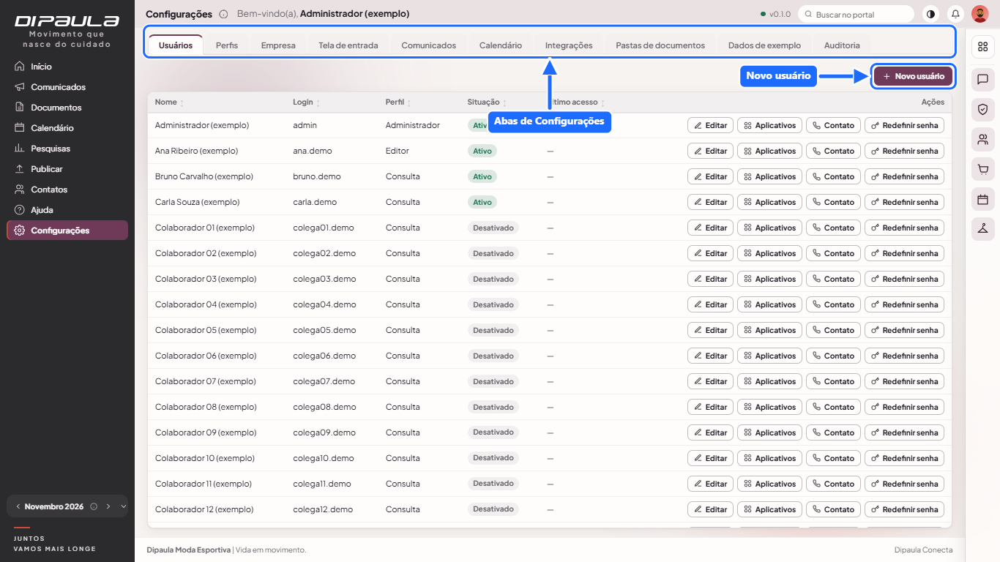
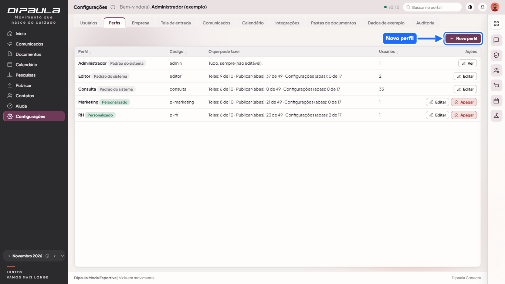
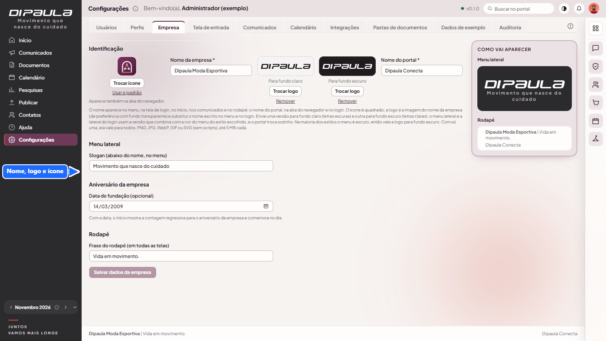
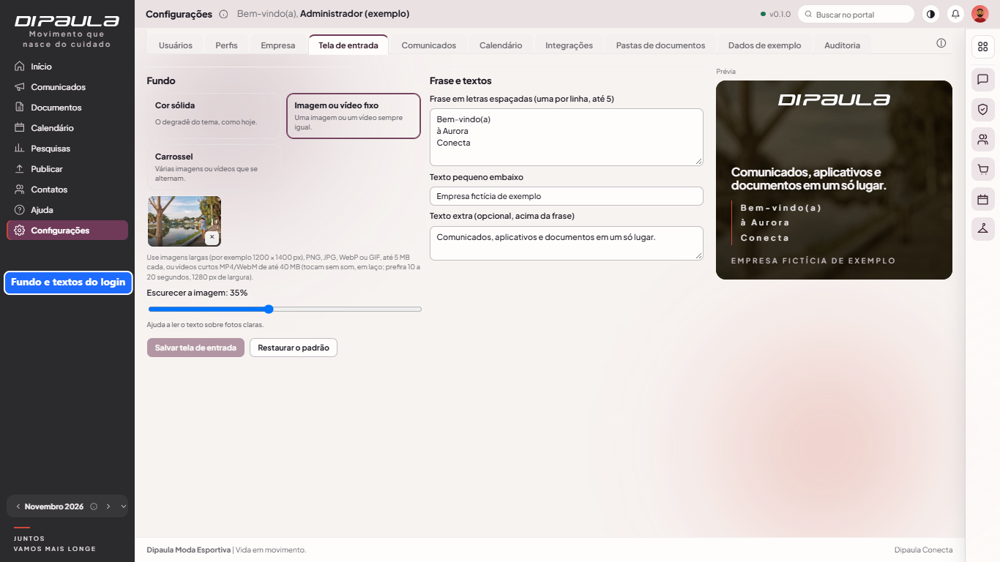
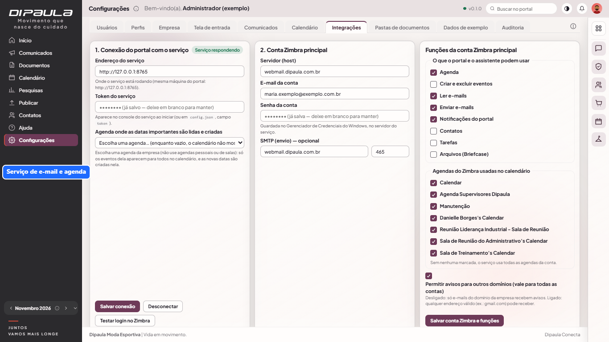
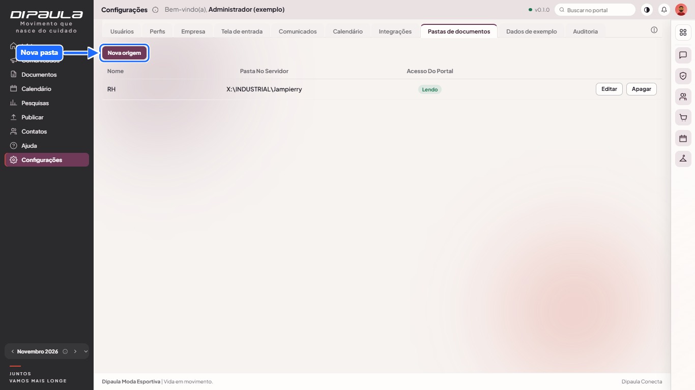
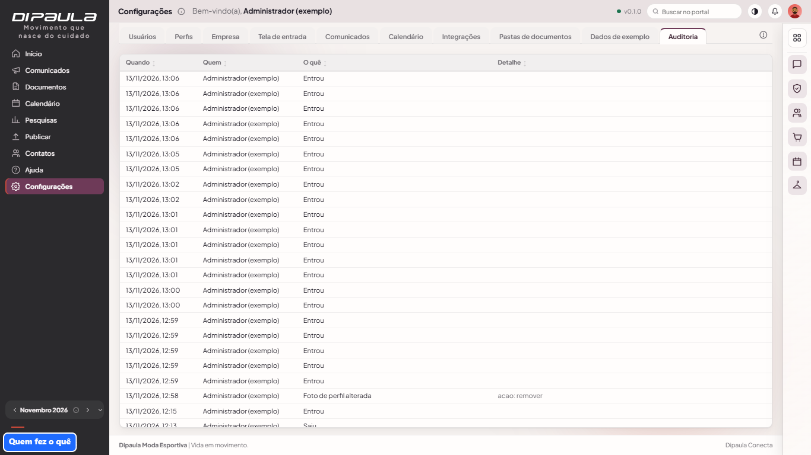

# Manual do administrador

Para o administrador do portal e a TI. Detalhes técnicos de instalação em [implantação](../implantacao.md); permissões em [permissões e perfis](../permissoes-e-perfis.md).

## 1. Primeiro acesso e administrador
- `npm run admin:criar -- <login> "<Nome>"` cria o primeiro administrador (com senha provisória). O `npm run banco:seed` cria `admin/admin123` **só para desenvolvimento**.
- Em produção defina `NODE_ENV=production` e `ORIGENS_PERMITIDAS` (endereço público do portal, com https).

## 2. Configurações (abas)
Cada aba aparece só para quem recebeu a permissão.

### Usuários

- **Novo usuário:** login (3 a 32 caracteres), nome, e-mail (opcional, usado nos avisos), **perfil** e **senha provisória** (o sistema sugere uma). A pessoa troca no primeiro acesso.
- **Editar:** nome, e-mail, perfil, ativo/desativado e **ajustes por pessoa** (permitir ou negar itens por cima do perfil).
- **Aplicativos:** libera aplicativos restritos só para aquela pessoa.
- **Redefinir senha:** gera nova senha provisória e desconecta a pessoa. Pedidos de "esqueci a senha" aparecem no topo da aba (e no sino): redefina ou dispense.
- **Contato:** abre a ficha de contato e emergência (permissão própria; fica na auditoria).
- Quem não é administrador não cria nem promove administradores.

### Perfis

Crie e edite perfis: nome e grade de permissões por tela e aba (ver, criar, editar, excluir e ações especiais). Administrador, Editor e Consulta são do sistema; os outros podem ser apagados (não se apaga um perfil que ainda tem usuários). Aqui também se liberam os **aplicativos restritos por perfil**.

### Empresa

Nome da empresa e do portal, frase do rodapé e ícone/logo (SVG passa por filtro de segurança).

### Tela de entrada

Fundo da lateral (imagem ou carrossel com transição), marca, lema, frase e textos. No computador o painel do login tem fundo animado e cartão de vidro; no celular a imagem ocupa a tela por trás do cartão.

### Comunicados
Configuração dos avisos de novos comunicados por e-mail (via serviço Zimbra) e contas de envio.

### Calendário
Datas importantes e feriados locais (com importação de feriados) e escolha das agendas do Zimbra exibidas.

### Integrações

Conexão com o serviço **zimbra-mcp** (separado, fora do Git, com credenciais): situação, teste, contas de e-mail/agenda e OAuth (Google/Microsoft). Em produção depende da TI (endereço de retorno real cadastrado nos provedores).

### Pastas de documentos (só administrador)

Cadastre as **origens**: pastas do servidor ou da rede (ex.: RH = `\\servidor\rh\Documentos`). O editor escolhe o arquivo com o seletor "Procurar…". O usuário que roda o serviço precisa de **leitura** nessas pastas.

### Dados de exemplo (só administrador)
Liga e desliga a empresa fictícia **Aurora Esportes** (`npm run demo` faz o mesmo). **Em produção é bloqueado** (a aba some) a menos que `PERMITIR_DADOS_EXEMPLO=1`.

### Auditoria

Registro só de inclusão de quem fez o quê e quando (login, criação, alteração, consulta de ficha de emergência etc.). **Nunca** guarda senhas nem o conteúdo do perfil pessoal.

## 3. Rotinas
| Quando | O que fazer |
|---|---|
| Diário | `npm run backup` agendado (Agendador de Tarefas ou cron), levando a pasta de backup e `DOCUMENTOS_PASTA` ao backup da empresa |
| A cada atualização | backup → `git checkout <etiqueta>` → `npm ci` → `npm run build` → reiniciar o serviço → conferir `/api/saude` |
| Quando alguém sai | desativar o usuário (Editar › ativo) |
| Pedidos de senha | atender na aba Usuários |
| Trimestral | rever perfis e permissões; testar a **restauração** do backup; `npm audit` |

## 4. Quando algo dá errado
- **Ninguém consegue entrar em produção:** o cookie de sessão é `Secure`, então é preciso **HTTPS** por proxy reverso; confira `ORIGENS_PERMITIDAS` e `TRUST_PROXY=1`.
- **Imagens ou carrosséis não aparecem:** confira se o serviço está atualizado e recarregue com Ctrl+F5.
- **Documento da rede não abre:** o usuário do serviço está sem leitura na pasta, ou a origem foi movida.
- **E-mail ou agenda não funcionam:** confira o serviço zimbra-mcp (porta 8765, só local) e o OAuth.
- **Voltar atrás:** parar o serviço, restaurar o backup do banco, `git checkout` da etiqueta anterior, `npm ci`, `npm run build`, iniciar.
