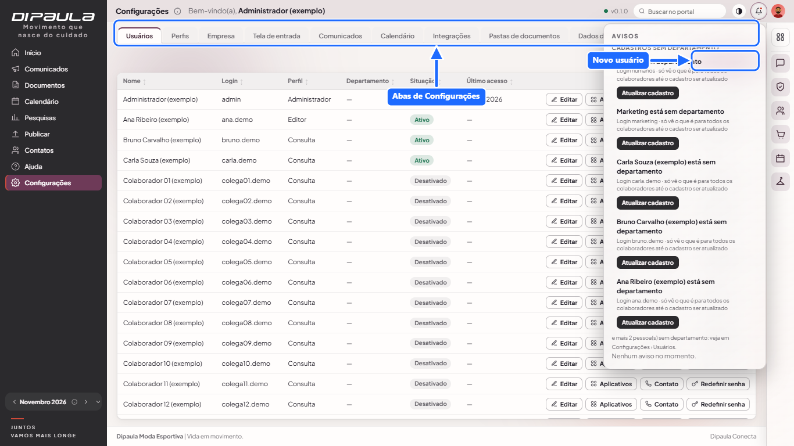
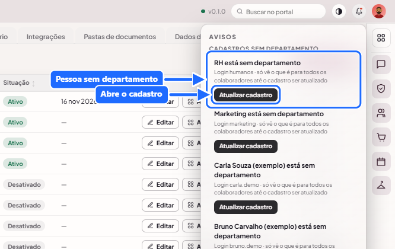
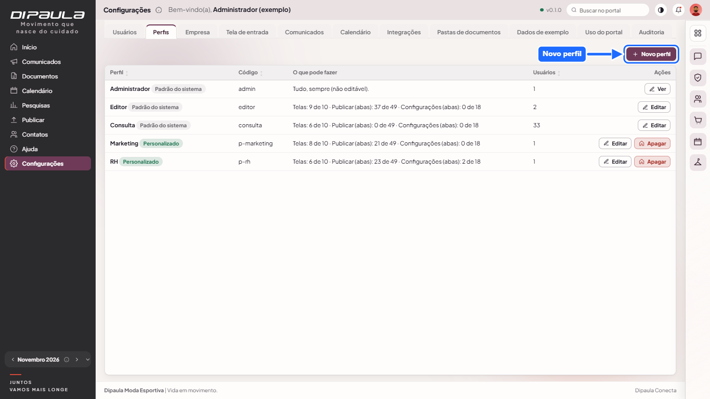
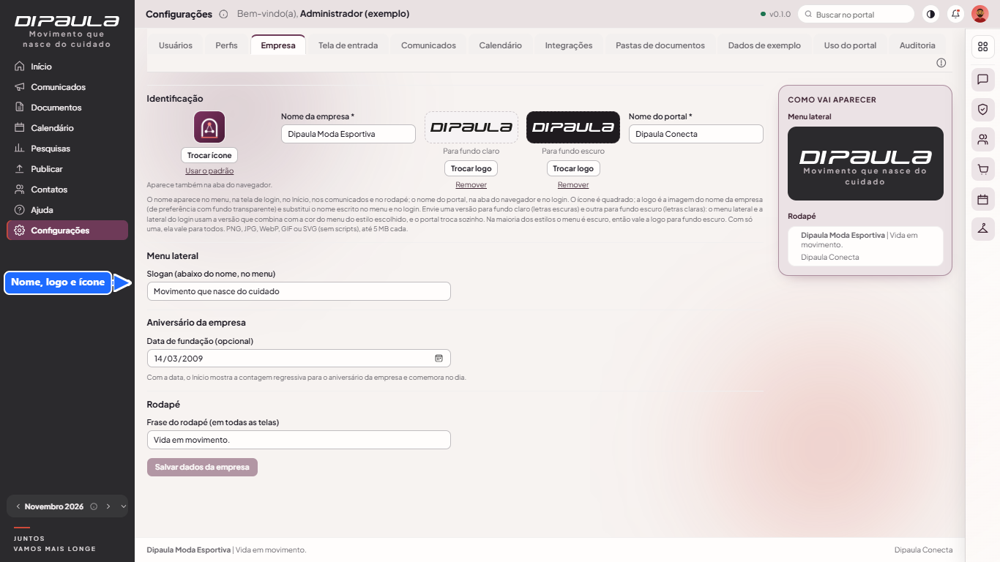
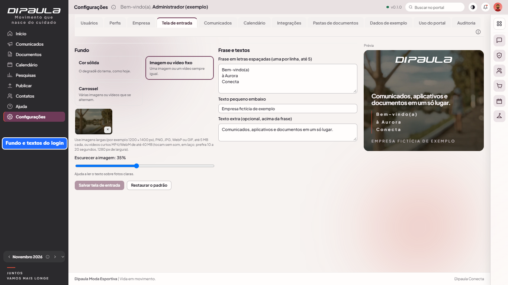
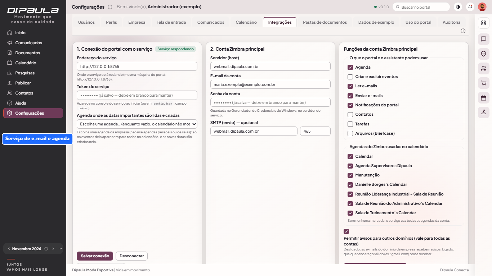
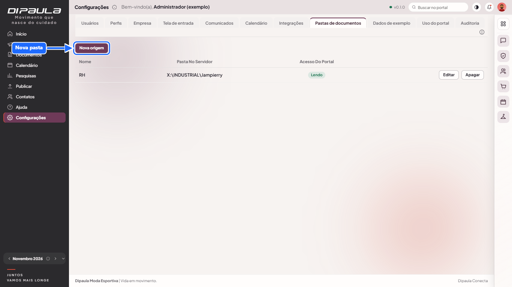
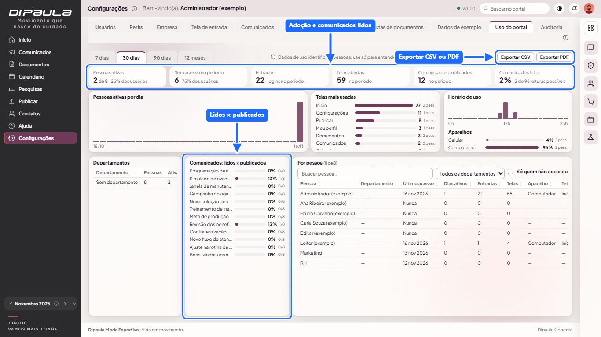
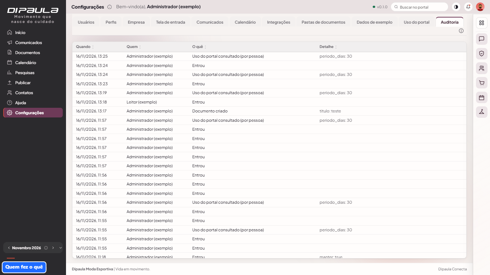

# Manual do administrador

Para o administrador do portal e a TI. Detalhes técnicos de instalação em [implantação](../implantacao.md); permissões em [permissões e perfis](../permissoes-e-perfis.md).

## 1. Primeiro acesso e administrador
- `npm run admin:criar -- <login> "<Nome>"` cria o primeiro administrador (com senha provisória). O `npm run banco:seed` cria `admin/admin123` **só para desenvolvimento**.
- O administrador tem **todas as permissões**: vê e faz tudo o que o RH vê e faz (aprovações, pesquisas, aniversariantes, avisos do sino etc.), além das configurações.
- Em produção defina `NODE_ENV=production` e `ORIGENS_PERMITIDAS` (endereço público do portal, com https).

## 2. Configurações (abas)
Cada aba aparece só para quem recebeu a permissão.

### Usuários

- **Duas abas:** **Com cadastro** (quem já tem usuário no portal) e **Sem cadastro (Keycloak)** (pessoas do login corporativo que ainda não têm usuário). A segunda aba só aparece para quem pode criar usuários.
- **Pesquisar e filtrar (Com cadastro):** o campo de pesquisa procura por nome, login ou e-mail; os filtros são **perfil**, **departamento** (inclui "Sem departamento") e **situação** (Ativo, Aguardando 1º acesso, Desativado). O contador mostra "N de M".
- **Sem cadastro (Keycloak):** lista as pessoas do Keycloak que não têm usuário (o portal cruza pelo e-mail ou pelo login). Há pesquisa, filtro de situação no Keycloak e **Atualizar lista** (a lista fica guardada por 2 minutos). **Cadastrar** abre o formulário já preenchido com nome, login e e-mail: ajuste o que for preciso, escolha o **perfil** e o **departamento** e salve. A pessoa entra pelo botão do login corporativo, **sem senha local**; o e-mail precisa ser o corporativo, porque é por ele que o Keycloak a reconhece. Para a aba funcionar, a TI precisa ligar "Service accounts" no cliente do portal no Keycloak e dar à conta de serviço o papel **view-users** (realm-management), ou informar um cliente próprio em `KEYCLOAK_ADMIN_CLIENT_ID` e `KEYCLOAK_ADMIN_CLIENT_SECRET`. Sem isso, a aba mostra uma mensagem dizendo o que pedir.
- **Novo usuário:** login (3 a 32 caracteres), nome, e-mail (opcional, usado nos avisos), **perfil** e **senha provisória** (o sistema sugere uma). A pessoa troca no primeiro acesso.
- **Editar:** nome, e-mail, perfil, ativo/desativado e **ajustes por pessoa** (permitir ou negar itens por cima do perfil).
- **Aplicativos:** libera aplicativos restritos só para aquela pessoa.
- **Desligar 2º fator:** para quem perdeu o aparelho com a biometria (veja "Biometria e manter conectado").
- **Pessoas sem departamento:** quem pode editar usuários recebe no sino um aviso com o nome de cada pessoa ativa sem departamento (o administrador não entra). O botão **Atualizar cadastro** abre a edição dela; ao escolher o departamento e salvar, o aviso some. Sem departamento, a pessoa só vê o que é para todos os colaboradores.

- **Redefinir senha:** gera nova senha provisória e desconecta a pessoa. Pedidos de "esqueci a senha" aparecem no topo da aba (e no sino): redefina ou dispense.
- **Contato:** abre a ficha de contato e emergência (permissão própria; fica na auditoria).
- Quem não é administrador não cria nem promove administradores.

### Perfis

Crie e edite perfis: nome e grade de permissões por tela e aba (ver, criar, editar, excluir e ações especiais). Administrador, Editor e Consulta são do sistema; os outros podem ser apagados (não se apaga um perfil que ainda tem usuários). Aqui também se liberam os **aplicativos restritos por perfil**.

### Empresa

Nome da empresa e do portal, frase do rodapé e ícone/logo (SVG passa por filtro de segurança).

### Tela de entrada

Fundo da lateral (imagem ou carrossel com transição), marca, lema, frase e textos. Ao lado da prévia, o quadro **Formato ideal** diz o tamanho certo: imagem **1200 × 1400 px** (6:7); vídeo MP4 (H.264) **1080 × 1260 px**, de 10 a 20 segundos, até 40 MB, que toca sem som e em laço. A mídia preenche o lado esquerdo e as bordas são cortadas conforme a janela: deixe o assunto no centro e sem texto escrito na mídia, porque o portal escreve a frase e a logo por cima. No computador o painel do login tem fundo animado e cartão de vidro; no celular a imagem ocupa a tela por trás do cartão.

### Comunicados
Agenda por **CalDAV** (endereço, usuário, senha e agenda da empresa; botão Salvar e testar lista as agendas; tem prioridade sobre o serviço Zimbra) e configuração dos avisos de novos comunicados por e-mail (via serviço Zimbra) e contas de envio.

### Calendário
Datas importantes e feriados locais (com importação de feriados) e escolha das agendas do Zimbra exibidas. A tabela mostra a data, o **dia da semana** (clique no título para ordenar), o título, o tipo e se repete.

### Integrações

Conexão com o serviço **zimbra-mcp** (separado, fora do Git, com credenciais): situação, teste, contas de e-mail/agenda e OAuth (Google/Microsoft). Em produção depende da TI (endereço de retorno real cadastrado nos provedores).

### Pastas de documentos (só administrador)

Cadastre as **origens**: pastas do servidor ou da rede (ex.: RH = `\\servidor\rh\Documentos`). O editor escolhe o arquivo com o seletor "Procurar…". O usuário que roda o serviço precisa de **leitura** nessas pastas.

**Pasta de documentos do portal:** os arquivos que quem publica **envia do próprio computador** (Publicar › Documentos) ficam na subpasta `Enviados/` da pasta de documentos do portal, num volume próprio do Docker (veja a implantação). Se o nome já existir, o portal acrescenta "(2)", "(3)"… e nunca sobrescreve. Entram no backup do volume (peça à infra).

### Dados de exemplo (só administrador)
Liga e desliga a empresa fictícia **Aurora Esportes** (`npm run demo` faz o mesmo). **Em produção é bloqueado** (a aba some) a menos que `PERMITIR_DADOS_EXEMPLO=1`.

### Uso do portal (permissão `cfg.uso.ver`)

Mostra se o portal é relevante, **por pessoa e por departamento**: pessoas ativas × cadastradas, quem não acessou, entradas e telas por período (7 dias, 30 dias, 90 dias ou 12 meses), pessoas ativas por dia, telas mais usadas, horário de uso, celular × computador, adoção por departamento, **comunicados lidos × publicados** (para cada comunicado do período, quantas pessoas do público abriram; confirmação de leitura também conta) e uma lista por pessoa (departamento, perfil, último acesso, dias ativos, entradas, telas, aparelho e tela preferida), com busca, filtro por departamento e "só quem não acessou". A tela foi pensada para caber na janela sem rolar a página; só a lista por pessoa rola por dentro. O departamento de cada pessoa é escolhido em **Usuários › Editar** (dá para criar um departamento ali mesmo).

**Exportar:** os botões **Exportar CSV** (planilha do Excel com resumo, dia a dia, telas, departamentos, comunicados e pessoas) e **Exportar PDF** (abre um relatório A4 e o navegador imprime: escolha "Salvar como PDF"; se nada abrir, permita pop-ups do portal). Cada exportação fica na Auditoria.

**Cuidados:** os dados identificam pessoas; use para entender a adoção, não para vigiar. Cada consulta da lista por pessoa fica na **Auditoria**. O portal guarda só data, tela e tipo de aparelho, por 12 meses. Informe os colaboradores (a linha de aviso está em Meu perfil e no manual do colaborador).

### Biometria e "manter conectado"

Cada pessoa cadastra a digital ou o rosto do aparelho em Meu perfil (o portal guarda só a chave pública). Exige HTTPS e o nome definitivo do portal (ver [pendências da TI](../pendencias-ti.md)); em `http://IP:porta` o botão não aparece. "Manter conectado" vale 30 dias. Se uma pessoa perder o aparelho, desative o usuário (derruba as sessões) ou redefina a senha; as biometrias podem ser removidas por ela em Meu perfil.

**Segundo fator (opcional):** quem tem biometria cadastrada pode ligar, em Meu perfil, "Pedir minha biometria também ao entrar com a senha". Com ele ligado, a senha sozinha não abre o portal: depois dela o aparelho pede a digital ou o rosto. Desligar exige a senha da pessoa. Se ela **perdeu o aparelho**, em **Usuários** use **Desligar 2º fator** (aparece só para quem tem o segundo fator ligado; exige a permissão de redefinir senha e fica na Auditoria); depois a pessoa cadastra o aparelho novo e liga de novo se quiser.

### Auditoria

Registro só de inclusão de quem fez o quê e quando (login, criação, alteração, consulta de ficha de emergência etc.). **Nunca** guarda senhas nem o conteúdo do perfil pessoal.

## 3. Rotinas
| Quando | O que fazer |
|---|---|
| Diário | `npm run backup` agendado (Agendador de Tarefas ou cron), levando a pasta de backup e `DOCUMENTOS_PASTA` ao backup da empresa |
| A cada atualização | backup → `git checkout <etiqueta>` → `npm ci` → `npm run build` → reiniciar o serviço → conferir `/api/saude` |
| Quando alguém sai | desativar o usuário (Editar › ativo) |
| Pedidos de senha | atender na aba Usuários |
| Trimestral | rever perfis e permissões; testar a **restauração** do backup; `npm audit` |

## 4. Quando algo dá errado
- **Ninguém consegue entrar em produção:** o cookie de sessão é `Secure`, então é preciso **HTTPS** por proxy reverso; confira `ORIGENS_PERMITIDAS` e `TRUST_PROXY=1`.
- **Imagens ou carrosséis não aparecem:** confira se o serviço está atualizado e recarregue com Ctrl+F5.
- **Documento da rede não abre:** o usuário do serviço está sem leitura na pasta, ou a origem foi movida.
- **E-mail ou agenda não funcionam:** confira o serviço zimbra-mcp (porta 8765, só local) e o OAuth.
- **Voltar atrás:** parar o serviço, restaurar o backup do banco, `git checkout` da etiqueta anterior, `npm ci`, `npm run build`, iniciar.

## Entrar pelo login corporativo (Keycloak)
Na tela de entrada, o botão **Entrar com login corporativo** aparece quando o Keycloak está ligado no ambiente. Quem é do domínio e ainda não tem cadastro entra como **Consulta** (só leitura): o portal cria o usuário na hora, com o nome e o e-mail do Keycloak e sem senha local. Para quem precisa de mais acesso (Editor, RH etc.), abra **Configurações › Usuários**, edite a pessoa e escolha o perfil; o login seguinte não desfaz a sua escolha. Para impedir alguém, desative o usuário: ele deixa de entrar mesmo existindo no Keycloak.
