# Manual do colaborador

Para todas as pessoas que usam o portal, no computador ou no celular.

## 1. Entrar

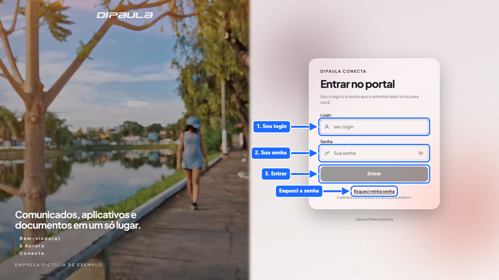
1. Abra o endereço do portal e informe o **login** e a **senha** que o administrador criou para você.
2. No primeiro acesso a senha é provisória: o portal pede que você crie uma senha só sua (mínimo de 8 caracteres, com número ou símbolo; senhas comuns como "senha123" são recusadas).
3. Depois de **5 tentativas erradas** neste aparelho o login fica bloqueado por **15 minutos** (o bloqueio vale para o seu login naquele endereço, não trava você em outro lugar).
4. **Esqueci a senha:** na tela de entrada use "Esqueci minha senha". O administrador recebe o aviso, redefine e passa uma senha provisória.
5. A sessão dura 12 horas; depois disso é preciso entrar de novo.

## 2. Conhecer a tela

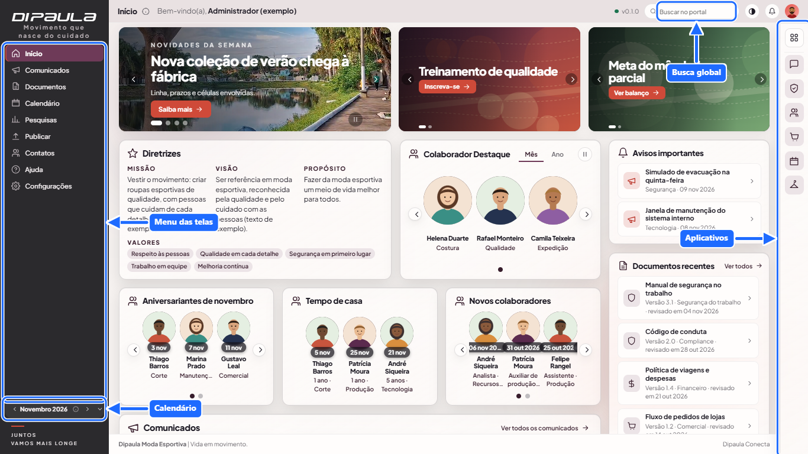

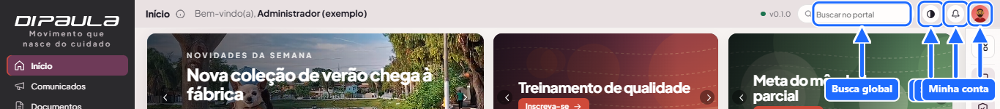

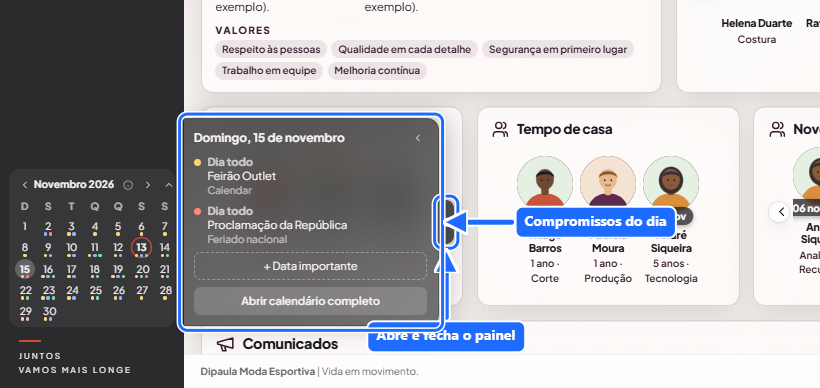

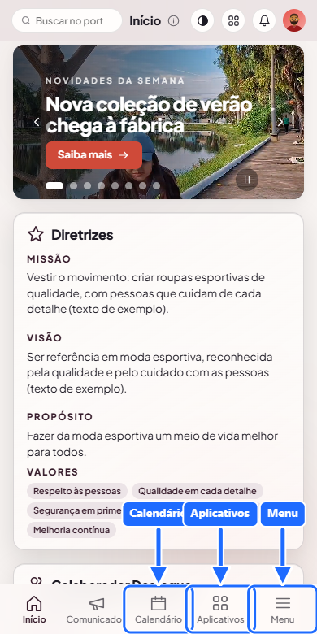
- **Menu à esquerda:** Início, Comunicados, Documentos, Contatos, Pesquisas, Ajuda e, se você tiver permissão, Publicar e Configurações. O botão no topo do menu recolhe e expande. No celular o menu abre como gaveta.
- **Calendário no menu:** fica embaixo do menu, junto da frase da empresa. Clique num dia, ou na setinha na borda direita do calendário, para abrir à direita a lista de compromissos do dia; clique de novo na setinha para recolher. Em "Abrir calendário completo" você vai para a tela cheia.
- **Barra superior:** título da tela, **busca global**, **temas**, **sino** de avisos e o **avatar** (menu da conta).
- **Barra de aplicativos à direita:** seus favoritos e o botão de grade com todos os aplicativos. No celular, toque em **Aplicativos**: abre uma faixa estreita com os favoritos; toque no ícone de grade do topo da faixa para ver a lista completa e na seta para voltar à faixa; toque fora para fechar.
- **Rodapé:** nome da empresa e do portal.

## 3. Início
Reúne novidades em três carrosséis, missão, visão e valores, **Colaborador Destaque**, aniversariantes e novos colaboradores do mês, avisos importantes, comunicados e documentos recentes. O que você vê depende das suas permissões.

## 4. Comunicados

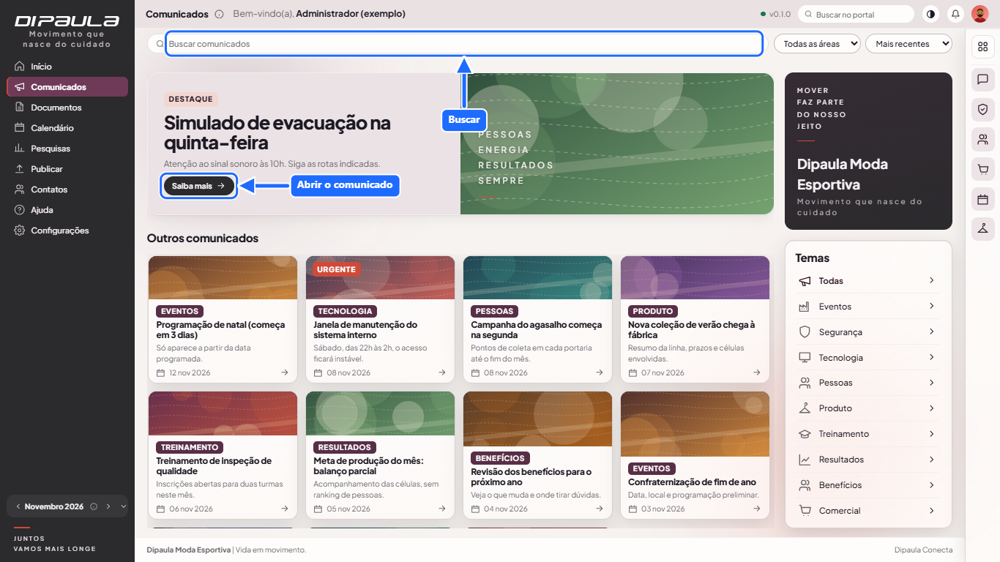
- Lista com busca e filtro por área; clique para ler o texto completo.
- Os **urgentes** aparecem também no sino e em "Avisos importantes" no Início.
- Alguns comunicados pedem **confirmação de leitura**: clique em **"Li e estou ciente"**. Enquanto não confirmar, ele continua em Avisos.

## 5. Documentos

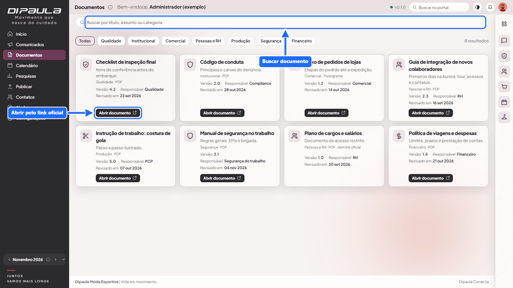
Cada documento mostra versão, responsável e data de revisão. Abra sempre pelo **link oficial** para usar a versão vigente. Alguns documentos são **restritos** e só aparecem para quem tem acesso. Um documento pode ter data de publicação futura: só aparece a partir dela.

## 6. Contatos

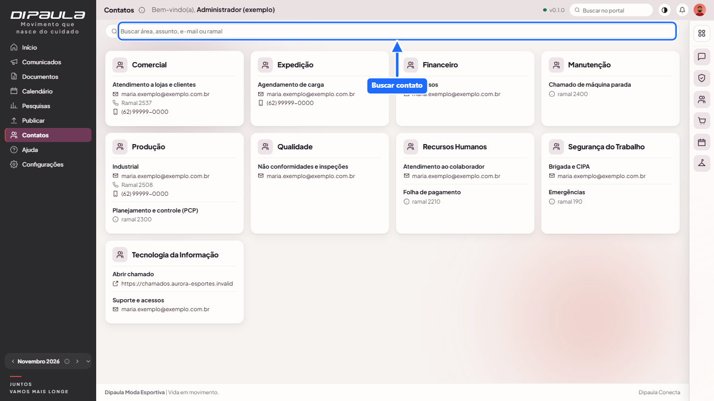
Canal de cada área (e-mail, ramal, celular corporativo ou link). Se não achar, use a busca do topo.

## 7. Aplicativos

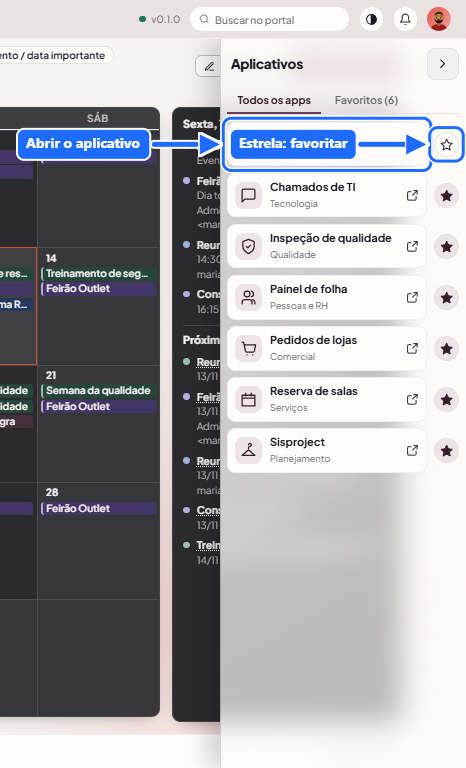

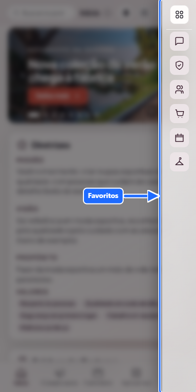
- Clique no ícone de grade na barra da direita para ver os aplicativos e abrir um.
- **Computador:** o aplicativo abre em **nova aba** e o portal continua aberto. **Celular:** abre na **mesma aba**; use **Voltar** do navegador para retornar.
- Clique na **estrela** para favoritar. Os favoritos ficam na sua conta e aparecem como ícones na barra.
- Alguns aplicativos são **restritos** e só aparecem para quem foi liberado.

## 8. Pesquisas

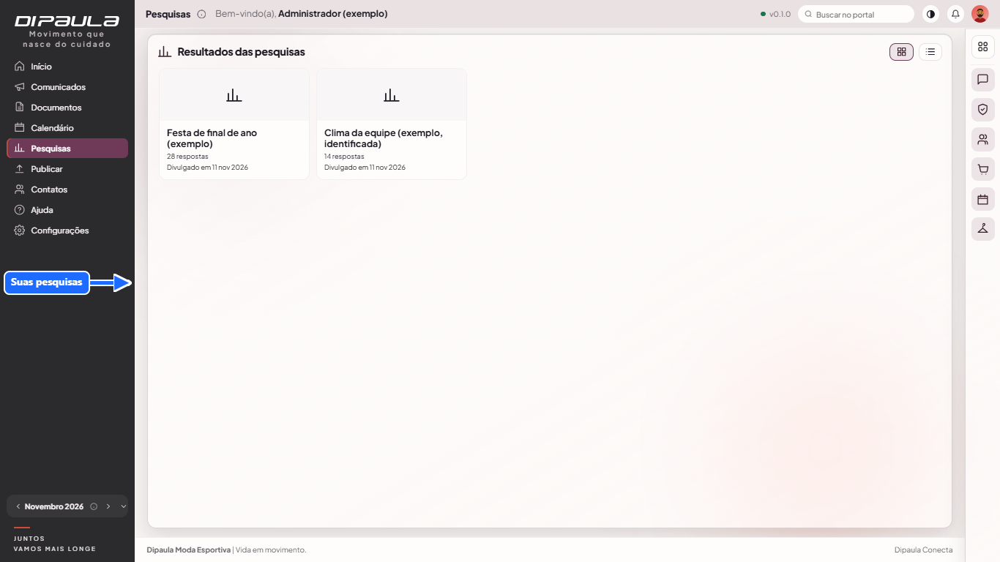
- Quando há pesquisa aberta para você, um **pop-up em passos** aparece (com bolinhas de progresso). Responda, ou feche e responda depois na tela **Pesquisas**.
- Pesquisas **anônimas** (padrão) não ligam sua resposta ao seu nome. Pesquisas **identificadas** avisam isso antes.
- Quando o RH divulga o resultado, um pop-up aparece uma vez; depois ele fica na tela **Pesquisas**.

## 9. Sino de avisos

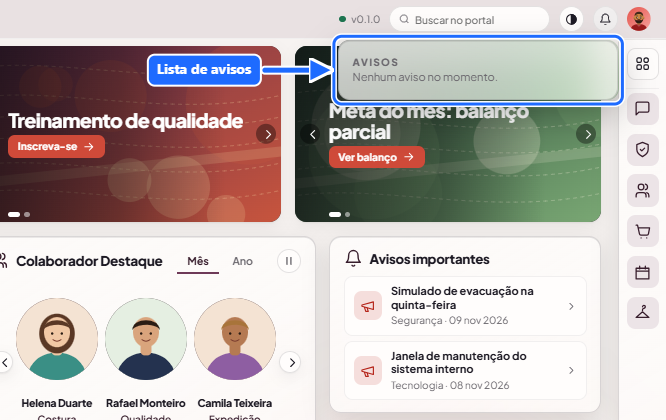
Mostra comunicados urgentes, pedidos de autorização de edição, respostas de aprovação e outros avisos. O que você abre ou limpa vale em qualquer aparelho. Em **Meu perfil › Avisos** você escolhe receber também por **e-mail** e por **notificação push** neste aparelho.

## 10. Calendário

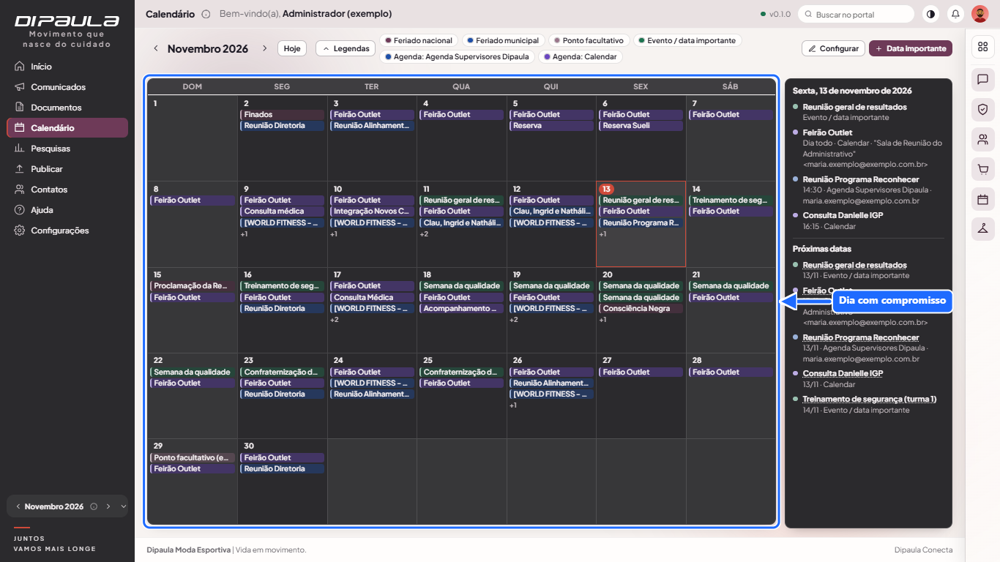
Datas importantes, feriados e compromissos da empresa. Um compromisso que se repete aparece em cada dia em que acontece. As **Legendas** mostram o que cada cor significa e deixam esconder o que você não quer ver. No celular a grade mostra o número do dia e pontinhos coloridos; **toque no dia** para ver os compromissos logo abaixo.

## 11. Busca global
A busca do topo procura em comunicados, documentos, aplicativos e contatos, **só no que você pode ver**. No celular, nas telas que já têm busca própria (Comunicados, Documentos, Contatos e Ajuda), a busca do topo fica escondida para não duplicar.

## 12. Temas e aparência

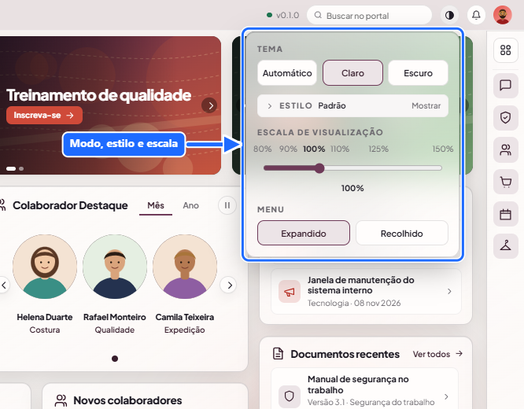
O botão de temas no topo muda o modo **claro/escuro**, o **estilo** (Di Paula, Bordô, Meia-noite, Ardósia, Grafite, Oceano), o tamanho (escala) e o modo compacto. A escolha fica neste navegador. Em telas menores (monitor de 19", notebook) o portal já se ajusta sozinho para manter o mesmo layout das telas grandes; se as letras ficarem pequenas, aumente a escala (110% ou 125%).

## 13. Meu perfil

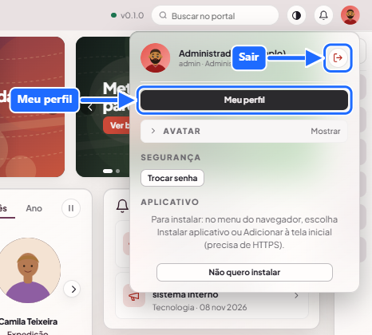

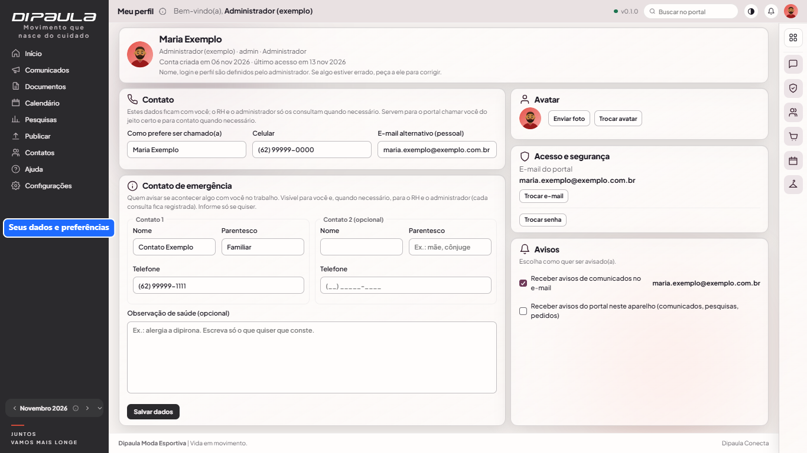
Abra pelo avatar › **Meu perfil**.
- **Contato:** como prefere ser chamado(a), celular e e-mail alternativo.
- **Contato de emergência** (dois contatos e observação de saúde): preenchimento opcional. Você vê os seus dados; o **RH e o administrador só os consultam quando necessário e cada consulta fica registrada**.
- **Foto e avatar:** envie uma foto (PNG, JPG, WebP ou GIF, até 5 MB) ou escolha um avatar. A foto vale em qualquer aparelho; o avatar escolhido fica neste navegador.
- **Acesso e segurança:** trocar o e-mail do portal (pede a senha atual) e trocar a senha.
- **Avisos:** e-mail e push.
- Nome, login e perfil de acesso só o administrador altera.

## 14. Dúvidas frequentes
- **Não vejo uma tela ou aplicativo:** falta permissão. Fale com o administrador.
- **Quero editar algo que outra pessoa publicou:** o portal oferece **pedir autorização** ao autor e ao administrador; ela vale por 24 horas e você é avisado no sino.
- **Não quero aparecer como Colaborador Destaque:** fale com o editor responsável; o reconhecimento exige o consentimento da pessoa.
- **O portal está estranho depois de uma atualização:** recarregue a página (Ctrl+F5).
