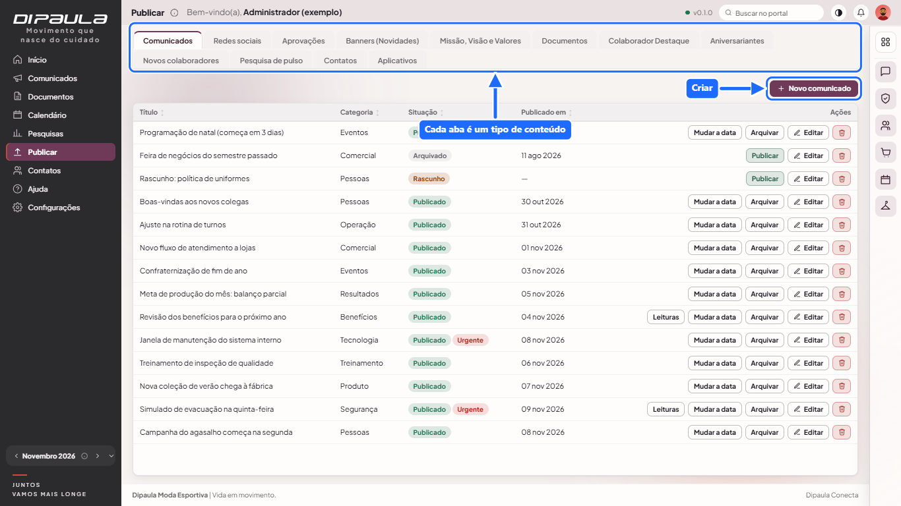
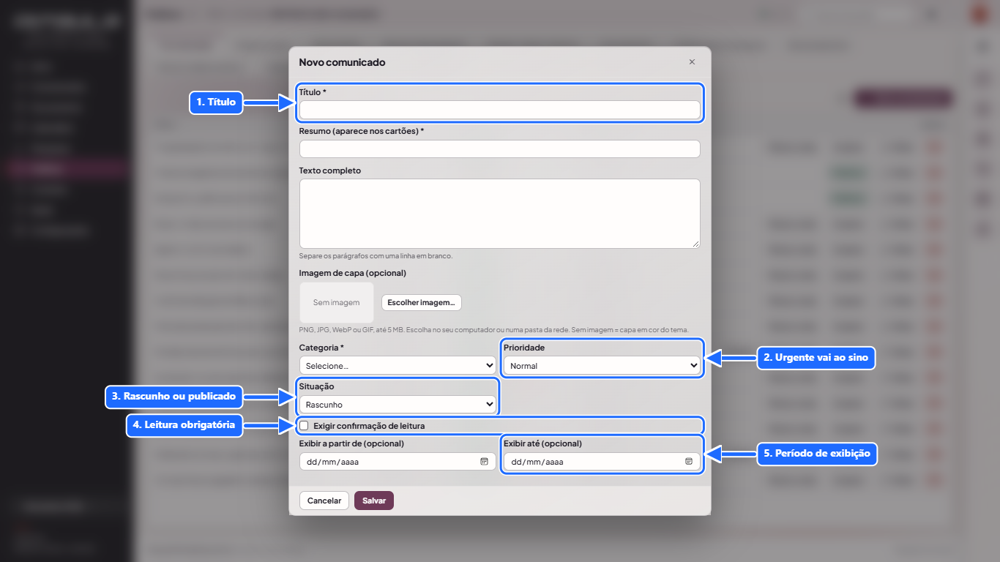
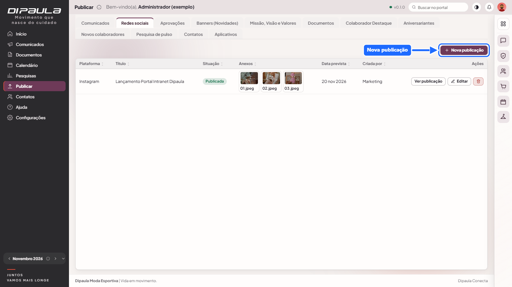
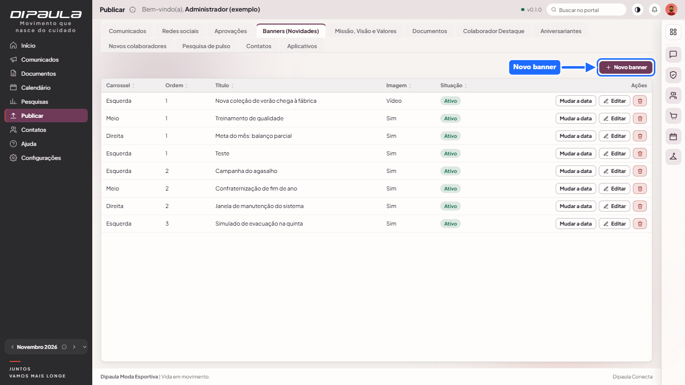
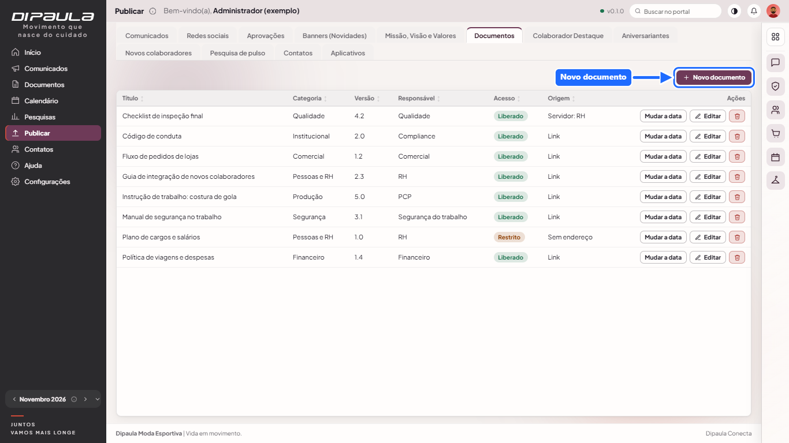
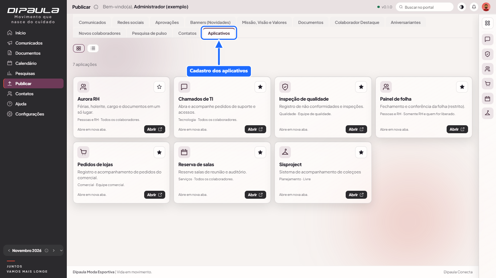

# Manual de quem publica (Publicar)

Para editores, Marketing e quem cuida do conteúdo. O menu **Publicar** mostra só as abas que o seu perfil permite. Cada aba tem lista com ordenação por cabeçalho, botão para criar e ações para editar e excluir.

## Regras que valem em todas as abas

- **Dono do conteúdo:** quem cria é o dono. **Apagar** conteúdo de outra pessoa só o administrador faz. **Editar** conteúdo de outra pessoa exige **pedir autorização**: o portal oferece enviar o pedido ao dono e ao administrador; a autorização vale **24 horas**.
- **Aprovação do RH:** se o seu perfil (ou o seu usuário) tem "precisa de aprovação" em Comunicados, Redes sociais, Banners ou Documentos, ao salvar você **envia para aprovação**. O RH aprova ou rejeita (com motivo). Você recebe a resposta no sino. Só depois de aprovado o conteúdo é publicado.
- **Mudar a data:** comunicados, banners, documentos e redes sociais têm "Mudar a data" para reprogramar a publicação.
- **Imagens:** PNG, JPG, WebP ou GIF até 5 MB, guardadas no próprio portal.
- Tudo o que você altera fica na **auditoria**.

## Abas
### Comunicados

Título, resumo (aparece nos cartões), texto completo, imagem de capa (opcional), categoria, **prioridade** (urgente aparece no sino e nos Avisos importantes), situação (rascunho, publicado, arquivado), **exigir confirmação de leitura** e janela de exibição (**exibir a partir de / até**). Depois de publicado, "Leituras" mostra quem confirmou.

### Redes sociais

Planejamento das publicações do Marketing: plataforma, título, legenda, imagem, link, **data prevista** e **anexos** (PDF, Word, Excel, PowerPoint, imagens, SVG e texto, com miniatura). Fluxo: rascunho → **enviada para aprovação** → aprovada ou rejeitada (com motivo) → **marcada como publicada** (com o link da publicação).

### Aprovações
Só para quem tem permissão (RH). Veja o [manual do RH](manual-rh.md).

### Banners (Novidades)

Alimentam os três carrosséis do topo do Início. Escolha **em qual carrossel** aparece (esquerda, meio ou direita), título, subtítulo (só no da esquerda), imagem, botão (texto e link), ordem, ativo e janela de exibição. Sem banner ativo o Início mostra a faixa padrão.

### Missão, Visão e Valores
Textos institucionais do Início (um valor por linha). Há também as diretrizes, com propósito.

### Documentos

Título, resumo, categoria, formato, **versão**, **responsável**, **quem pode ver** (classificação), **revisado em**, **publicar a partir de** e **onde está o documento**:
- um **link** http(s);
- um **arquivo na pasta de documentos do portal**; ou
- um arquivo numa **pasta do servidor** cadastrada pelo administrador (escolha "Servidor: origem" e clique no arquivo; não é preciso digitar caminho de rede).

### Colaborador Destaque
Nome, área, mês e ano, foto (opcional), texto de reconhecimento e **referência do consentimento** (obrigatória). É um reconhecimento sem ranking e sem pontuação.

### Aniversariantes, Novos colaboradores e Pesquisas
Normalmente do RH (ver [manual do RH](manual-rh.md)).

### Contatos
Área, assunto/contato, canal (e-mail ou link), ramal, celular corporativo e "aparece no portal". **Sem dados pessoais.**

### Aplicativos

Cadastro dos aplicativos (links): nome, categoria, descrição, **endereço http(s)**, condição de acesso, responsável, ícone (envie uma imagem ou use o ícone automático), ativo e **restrita** (só aparece para quem for liberado por perfil ou por pessoa). Só URLs http(s).

## Boas práticas
- Use rascunho para revisar antes de publicar.
- Escreva resumo curto: ele aparece nos cartões e no Início.
- Marque **urgente** só quando for realmente urgente, para o sino não perder o valor.
- Para aviso de leitura obrigatória, use a confirmação de leitura.
- Use imagens leves; se houver informação importante nelas, repita no texto.
