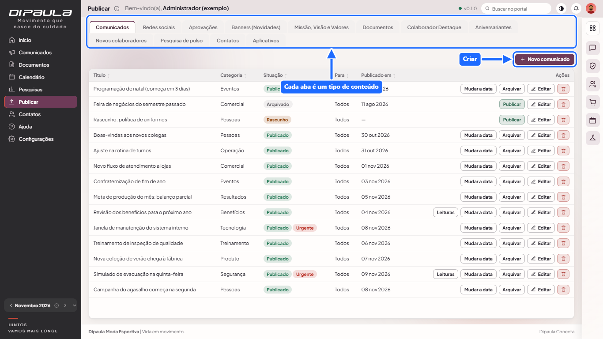
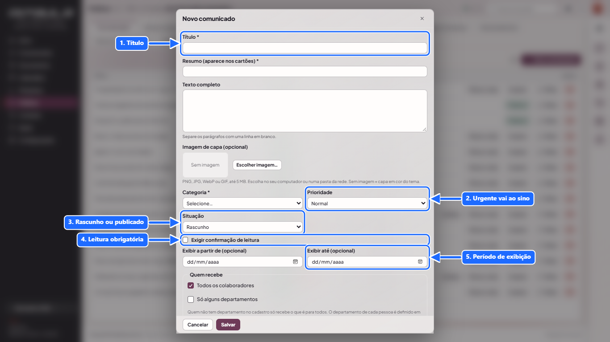
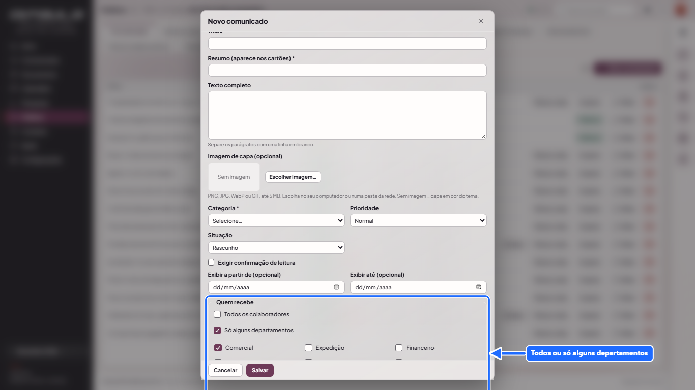
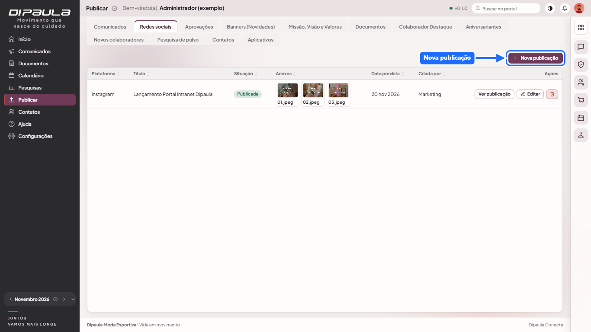
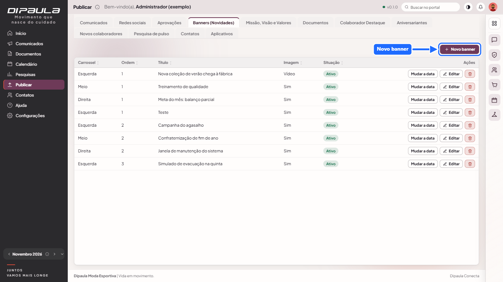
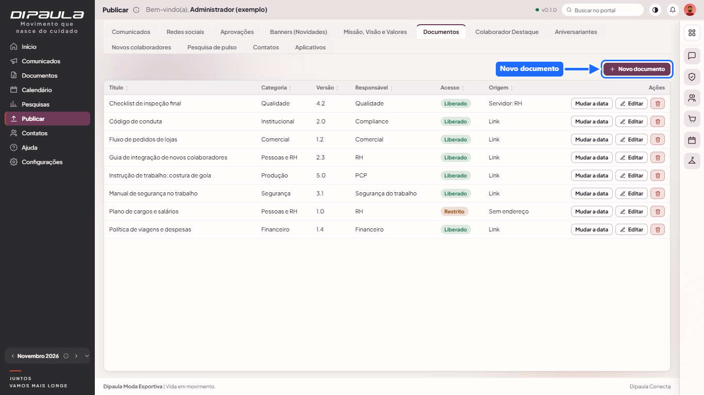
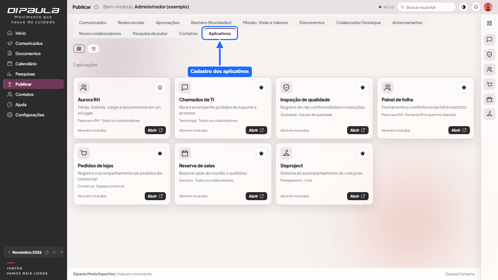

# Manual de quem publica (Publicar)

Para editores, Marketing e quem cuida do conteúdo. O menu **Publicar** mostra só as abas que o seu perfil permite. Cada aba tem lista com ordenação por cabeçalho, botão para criar e ações para editar e excluir.

## Regras que valem em todas as abas

- **Dono do conteúdo:** quem cria é o dono. **Apagar** conteúdo de outra pessoa só o administrador faz. **Editar** conteúdo de outra pessoa exige **pedir autorização**: o portal oferece enviar o pedido ao dono e ao administrador; a autorização vale **24 horas**.
- **Aprovação do RH:** se o seu perfil (ou o seu usuário) tem "precisa de aprovação" em Comunicados, Redes sociais, Banners ou Documentos, ao salvar você **envia para aprovação**. O RH aprova ou rejeita (com motivo). Você recebe a resposta no sino. Só depois de aprovado o conteúdo é publicado.
- **Mudar a data:** comunicados, banners, documentos e redes sociais têm "Mudar a data" para reprogramar a publicação.
- **Prévia ao vivo:** nos formulários de Comunicados, Banners, Documentos, Colaborador Destaque, Aniversariantes, Novos colaboradores, Aplicativos e Redes sociais, a **direita do formulário mostra como o conteúdo vai aparecer** e se atualiza enquanto você digita, com avisos do que falta ou do que muda (por exemplo, "Rascunho: não aparece no portal"). No celular a prévia fica no alto.
- **Ajuda nos campos:** a explicação de cada campo fica no ícone redondo **"!"** ao lado do nome do campo; clique para ler. O balão abre por cima da janela, sem ser cortado.
- **Nova categoria:** ao escolher "+ Nova categoria…", o próprio campo vira um texto (botão **Lista** volta ao seletor).
- **Imagens:** PNG, JPG, WebP ou GIF até 5 MB, guardadas no próprio portal.
- Tudo o que você altera fica na **auditoria**.

## Abas
### Comunicados

Título, resumo (aparece nos cartões), texto completo, imagem de capa (opcional), categoria, **prioridade** (urgente aparece no sino e nos Avisos importantes), situação (rascunho, publicado, arquivado), **exigir confirmação de leitura** e janela de exibição (**exibir a partir de / até**). Depois de publicado, "Leituras" mostra quem confirmou.

**Quem recebe:** por padrão o comunicado vai para **todos**. Para um grupo, marque **Só alguns departamentos** e escolha os departamentos; só quem é desses departamentos vê o comunicado (lista, busca, sino, push e e-mail), e "Leituras" passa a cobrar só essas pessoas. A lista da aba mostra a coluna **Para**. Quem ainda não tem departamento no cadastro só recebe o que é para todos (o departamento de cada pessoa é definido em Configurações › Usuários). É assim que se manda uma **mensagem** dirigida: um comunicado para os departamentos escolhidos.

### Redes sociais

Planejamento das publicações do Marketing: plataforma, título, legenda, imagem, link, **data prevista** e **anexos** (PDF, Word, Excel, PowerPoint, imagens, SVG e texto, com miniatura). Fluxo: rascunho → **enviada para aprovação** → aprovada ou rejeitada (com motivo) → **marcada como publicada** (com o link da publicação).

### Aprovações
Só para quem tem permissão (RH). Veja o [manual do RH](manual-rh.md).

### Banners (Novidades)

Alimentam os três carrosséis do topo do Início. Escolha **em qual carrossel** aparece (esquerda, meio ou direita), título, subtítulo (só no da esquerda), imagem ou vídeo, botão (texto e link), ordem, ativo e janela de exibição.
- **Os três carrosséis aparecem sempre.** O que não tem banner mostra uma arte fixa: a esquerda ("Destaques") a faixa padrão, o meio ("Avisos rápidos") e a direita ("Mais novidades") um quadro com ícone e a explicação do que ficará ali.
- **Prévia e formato ideal:** a prévia mostra o carrossel escolhido e o lugar dele no Início. O quadro **Formato ideal** orienta: esquerda, imagem 1000 × 330 px (≈ 3:1) e vídeo MP4 (H.264) horizontal 1920 × 630 px; meio e direita, imagem 700 × 330 px e vídeo 1400 × 660 px; vídeos de 6 a 15 segundos, até 40 MB, que tocam sem som e em laço.
- **Ajuste da mídia:** se a proporção é próxima da do carrossel, ela preenche tudo; se é muito diferente (por exemplo, um vídeo vertical), aparece **inteira, encostada à direita**, e as sobras são preenchidas com ela mesma desfocada, para não ficar atrás do texto. O texto fica à esquerda: deixe esse lado mais livre.
- **Link do botão:** pode ser uma página do portal, um comunicado, um **documento** ou um endereço externo. Ao escolher um documento (grupo **Documentos**, com pesquisa), o botão abre o **visualizador** do portal, com maximizar, imprimir e baixar, sem sair do Início.

### Missão, Visão e Valores
Textos institucionais do Início (um valor por linha). Há também as diretrizes, com propósito.

### Documentos

Título, resumo, categoria, formato, **quem pode ver** (classificação), **revisado em**, **publicar a partir de** e **onde está o documento**. A **versão** e o **responsável** são **automáticos**: o documento novo começa na versão **1.0** e a versão sobe (2.0, 3.0…) quando o arquivo ou o link é trocado ao editar; o responsável é **quem publicou**. Editar só o título ou o resumo mantém a versão.
- **enviar um arquivo do seu computador** (opção padrão): escolha o arquivo e ele é enviado na hora para a pasta de documentos do portal (PDF, Word, Excel, PowerPoint, imagem, TXT ou CSV, até 50 MB; o conteúdo é conferido);
- um **link** http(s);
- um **arquivo na pasta de documentos do portal**; ou
- um arquivo numa **pasta do servidor** cadastrada pelo administrador (escolha "Servidor: origem" e clique no arquivo; não é preciso digitar caminho de rede).
Para o arquivo enviado, o da pasta do portal e o da pasta do servidor, quem lê o documento tem o botão **Visualizar**: abre PDF, Word (.docx), Excel (.xlsx, como tabela), texto, CSV e imagem dentro do portal, com maximizar, imprimir e baixar. Outros formatos só baixam.

**Cartão do documento:** todos os cartões têm o mesmo tamanho. À direita fica uma **miniatura só da página** (primeira página do PDF, do Word ou do Excel, ou a imagem), centralizada; formatos sem miniatura mostram o ícone do tipo. O ícone da categoria fica no canto superior direito e o botão, centralizado no rodapé do cartão.

### Colaborador Destaque
Nome, área, mês e ano, foto (opcional), texto de reconhecimento e **referência do consentimento** (obrigatória). A prévia mostra o cartão como ele aparece no Início. É um reconhecimento sem ranking e sem pontuação.

### Aniversariantes, Novos colaboradores e Pesquisas
Normalmente do RH (ver [manual do RH](manual-rh.md)).

### Contatos
Área, assunto/contato, canal (e-mail ou link), ramal, celular corporativo e "aparece no portal". **Sem dados pessoais.**

### Aplicativos

Cadastro dos aplicativos (links): nome, categoria, descrição, **endereço http(s)**, condição de acesso, responsável, ícone (envie uma imagem ou use o ícone automático), ativo e **restrita** (só aparece para quem for liberado por perfil ou por pessoa). Só URLs http(s).

## Boas práticas
- Use rascunho para revisar antes de publicar.
- Escreva resumo curto: ele aparece nos cartões e no Início.
- Marque **urgente** só quando for realmente urgente, para o sino não perder o valor.
- Para aviso de leitura obrigatória, use a confirmação de leitura.
- Use imagens leves; se houver informação importante nelas, repita no texto.
