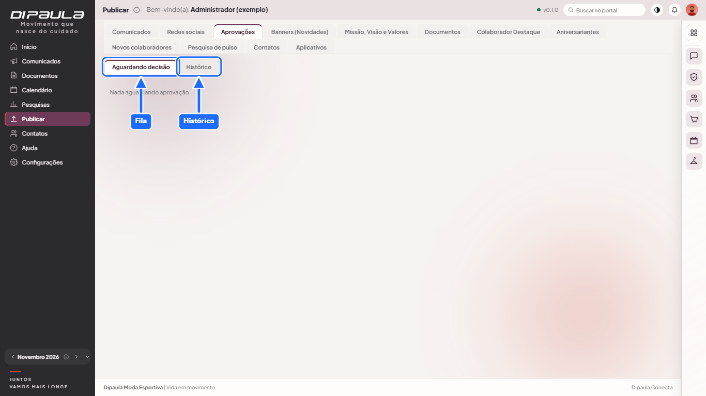
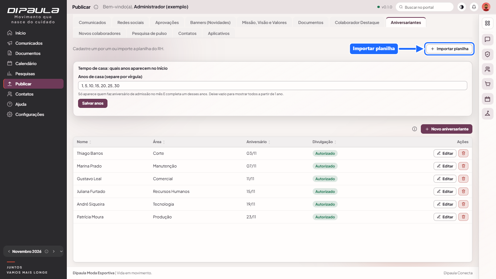
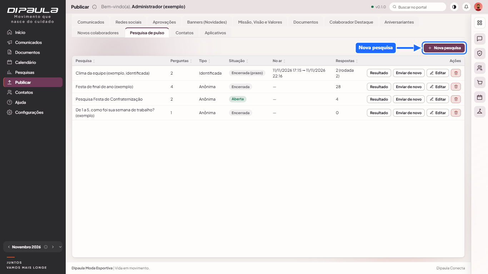
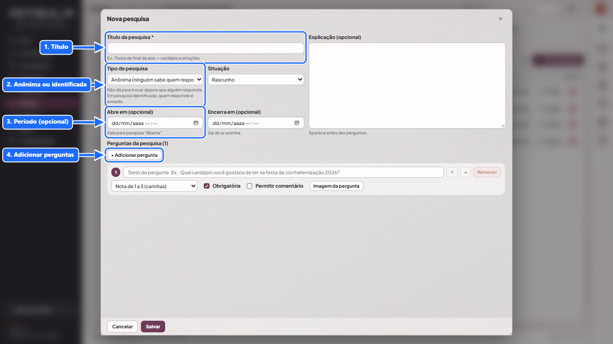

# Manual do RH

Para quem cuida de pessoas, pesquisas, aprovações e reconhecimento. O perfil **RH** já vem pronto (Configurações › Perfis) e pode ser ajustado.

## 1. Aprovações

Em **Publicar › Aprovações** o RH vê a **fila** (pendentes) e o **histórico**.
- Cada item mostra uma **prévia** (comunicados, redes sociais com anexos, banners, documentos) e um botão **Abrir**.
- **Aprovar** publica; **Rejeitar** exige um **motivo**, que a pessoa lê no sino.
- Quem precisa de aprovação é definido **por aba e por pessoa**: o administrador marca "Precisa da aprovação do RH para publicar" em Comunicados, Redes sociais, Banners e Documentos, nas permissões do perfil ou do usuário. Quem decide precisa de `pub.aprovacoes.ver` e `pub.aprovacoes.decidir`.
- Novos pedidos chegam no **sino**.

## 2. Aniversariantes e novos colaboradores

- **Aniversariantes:** cadastre manualmente ou **importe**. A **data de admissão** (opcional) mostra "N anos de casa".
- **Novos colaboradores:** cadastro de quem acabou de entrar.
- Ambos aparecem no Início, na seção de pessoas do mês. Use apenas dados autorizados.

## 3. Colaborador Destaque
Só com **consentimento registrado** da pessoa. Sem ranking nem pontuação.

## 4. Pesquisas (Publicar › Pesquisas)

**Montar**
- Título e explicação, com **várias perguntas**. Tipos: **nota de 1 a 5** (com comentário opcional), **escolha única**, **múltipla escolha** e **texto**. Cada pergunta pode ser obrigatória ou não e ter **imagem**; cada opção também pode ter imagem. Reordene com as setas; as perguntas ficam **minimizáveis** no editor.
- Escolha se a pesquisa é **anônima** (padrão) ou **identificada**.
- Defina o **período** (abre e fecha em data e hora) ou deixe sem prazo.
- Várias pesquisas podem estar abertas ao mesmo tempo. O pop-up mostra a mais recente ainda não respondida.
- Depois da **primeira resposta as perguntas travam**.
- **Reenviar:** abre uma nova **rodada** (para todos, ou só para quem não respondeu).

**Resultado** (permissão `pub.pulso.resultado`)
- O resultado só aparece com **5 ou mais respostas**; antes disso o portal mostra uma **prévia fictícia** para você conhecer o layout.
- Cartões por pergunta com barras, listas com rolagem e, nas identificadas, os nomes.

**Liberar aos colaboradores**
- Por pesquisa, o RH decide se **libera o resultado**; por pergunta, se o resultado aparece e se **comentários e textos** aparecem; também pode mostrar **só a opção mais votada**.
- Nomes (pesquisa identificada) **nunca** vão para os colaboradores.
- Ao liberar, os colaboradores veem um **pop-up uma única vez** e depois o resultado fica em **Pesquisas**.

## 5. Contato de emergência das pessoas
- Cada pessoa informa os próprios dados em **Meu perfil**. O RH só vê se tiver a permissão **"Ver o contato de emergência de cada pessoa"** (e "Ver a aba" de Usuários, para chegar à lista). Em **Configurações › Usuários**, clique em **Contato**.
- A janela é só de leitura (telefones clicáveis). **Cada consulta fica na auditoria.** Use só quando necessário (acidente, urgência).
- O perfil RH **não** recebe essa permissão sozinho: o administrador concede em Configurações › Perfis.

## 6. Cuidados com dados (LGPD)
- Peça só o necessário; os campos de emergência e saúde são opcionais.
- Não copie dados do portal para outros lugares sem necessidade.
- Resultados identificados são sensíveis: libere aos colaboradores somente o agregado.
